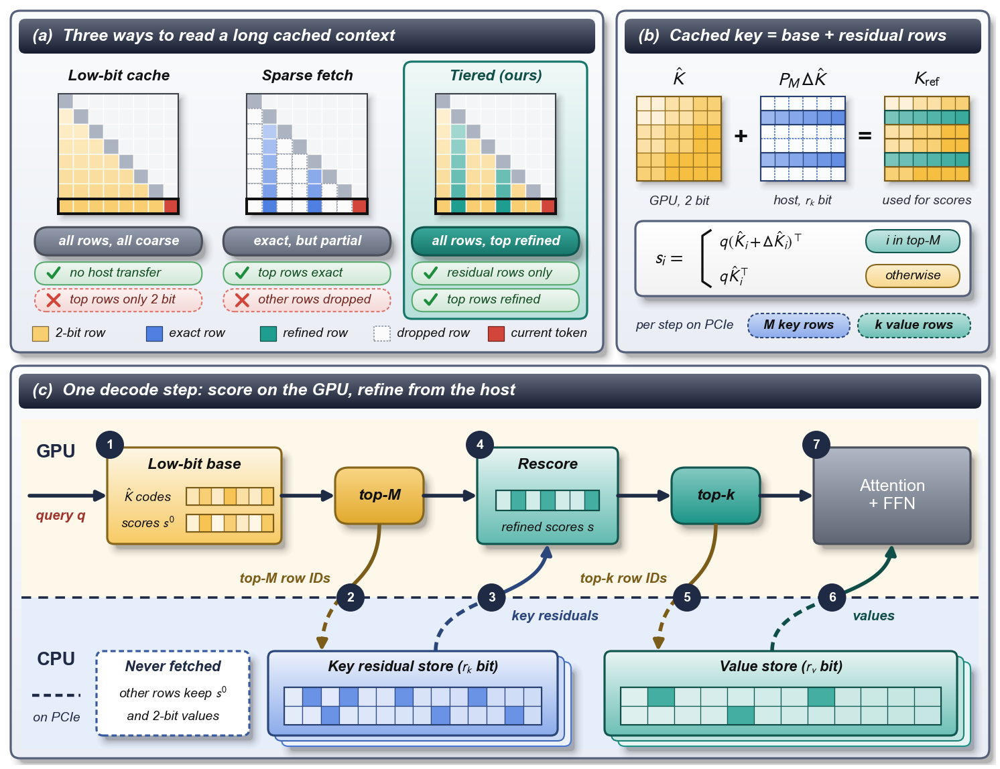

<div align="center">

# TieredKV

### Long-context LLM decoding with a low-bit GPU KV cache and selective host corrections

[](docs/reproduction.md)
[](docs/reproduction.md)
[](tieredkv/kernels)
[](integrations/vllm)
[](LICENSE)

[Library](tieredkv) &nbsp;|&nbsp; [Experiments](experiments) &nbsp;|&nbsp; [vLLM plugin](integrations/vllm)
&nbsp;|&nbsp; [Reproduction](docs/reproduction.md)

</div>

---

## The problem

At long context lengths, the KV cache, not the model weights, determines how many tokens fit on a GPU.
Existing workarounds face a sharp trade-off:

- **2-bit GPU caches** fit in VRAM, but quantization errors degrade the high-attention rows that generation
  depends on.
- **Full host offloading** keeps the cache exact in CPU RAM, but streams large slices of it over PCIe at every
  decode step.

## How TieredKV works

TieredKV splits the KV cache across GPU and host memory so that only a small fraction of bytes crosses PCIe:

- **On the GPU (low-bit base):** every token keeps a compact 2-bit base plus metadata (2.5-3 bits per element).
  The 4 attention sinks and the recent window stay exact in FP16.
- **On the host (quantized residuals):** the quantization error (exact minus base) is stored in pinned CPU
  memory as compact per-token residuals.
- **At each decode step (two-stage refinement):**
  1. score all cached rows on the GPU with the low-bit base;
  2. fetch host key residuals for only the top 128 rows and rescore them;
  3. fetch host value residuals for only the top 64 of those rows to refine the attention output.

Only the selected residual rows traverse PCIe: about 15 KB per layer and KV head per step.

<p align="center">
  
</p>

## Key results

| Benchmark / comparison | Highlight | Details |
|---|---|---|
| Fidelity at equal GPU memory | Decode KL is 59-81x lower than a 2-bit KIVI base (64/64 traces per model) and 34-87x lower than H2O-style eviction (Qwen3 0.6B-4B). | [fidelity_nab1](experiments/fidelity_nab1) |
| Same PCIe budget as exact-row fetch | Decode KL is 0.37x that of SpeCache-style exact-row fetch on a shared base (lower on 16/16 models). | [ladder_l1](experiments/ladder_l1) |
| Row-selection rule | Selecting rows by exact attention (the sparse-fetch rule) is 2.3x worse than selecting with the base's own scores (16/16 models). | [ladder_l1](experiments/ladder_l1) |
| vs. offloading systems at 130K | On the same RTX 4090: 7-22% of ShadowKV's and 5-55% of RetroInfer's PCIe bytes per step, and about 30% of their pinned host memory. Accuracy, each system in its own environment: 3-4 points above ShadowKV (budgets 1024-4096) and within RetroInfer's interval (Llama-3.1-8B, RULER, 250 items). | [same_gpu_offload](experiments/same_gpu_offload) |
| RULER vs. full attention | Llama-3.1-8B, identical token IDs, 10 items per task. 32K (all 13 tasks): 90.74 vs. 90.64, +0.10 [-0.31, +0.69]. 128K, 8 NIAH tasks: 91.88 vs. 93.12 / 91.88 across two full-attention runs (identical to the second run on 80/80 items); 128K, the 10 tasks of the ParisKV table: 86.17 vs. 87.30 / 87.97, -1.13 [-3.60, +0.67]. | [ruler_vs_full](experiments/ruler_vs_full) |
| 130K real decode engine | 71.4 vs. 72.7 at full precision (no difference detected); +8.9 [+1.6, +16.3] points over KIVI-128 on the same machine (Llama-3.1-8B, RULER). | [real_engine](experiments/real_engine) |
| Host memory demotion | Demoting cold host rows by attention score cuts host bytes by 13-16% at 1.05-1.07x the reasoning-span KL of the full store (Qwen3 0.6B-4B). | [demotion_t4](experiments/demotion_t4) |
| Metadata-free residual coding | Coding residuals in units of the stored base step removes the per-token metadata: 16% fewer host bytes (128 B) with no KL difference detected, 1.00 [0.98, 1.02] (Qwen3 0.6B and 4B, teacher-forced). | [residual_coding](experiments/residual_coding) |

## Technical design

1. **GPU base.** Keys are split by RoPE frequency-pair importance: the important half uses 3 bit and the rest
   1 bit, each after a Hadamard transform. Values use 2 bit per token.
2. **Host residuals.** The exact-minus-base residual is Hadamard-transformed and coded per token at 5 bit (keys)
   and 4 bit (values) in pinned host memory (`h54`, 152 B per token and KV head).
3. **Two-stage selection.** The GPU base scores all cached rows. The top M = 128 rows fetch key residuals for
   rescoring; the top k = 64 of those fetch value residuals for output correction.
4. **Unfetched rows.** The remaining rows keep their base scores, with a small logit correction derived from the
   stored quantization step.
5. **Fused Triton kernels and CUDA-graph engine.** The fused Triton kernels match the PyTorch reference bit for
   bit. The decode engine seals full pages into the GPU base and the host store and runs decode steps inside a
   CUDA graph.

## Repository layout

| Path | Contents |
|---|---|
| [`tieredkv/`](tieredkv) | Core library: PyTorch accuracy reference and selection (`reference/`), Triton kernels and byte layouts (`kernels/`), decode engine and PCIe meter (`engine/`), evaluation harness (`bench/`). |
| [`experiments/`](experiments) | One directory per study with the formal run scripts, analysis scripts and results; notation in [`experiments/README.md`](experiments/README.md). |
| [`integrations/vllm/`](integrations/vllm) | Staged vLLM plugin prototype: in-engine oracle backend (`TIERKV_M0`), host residual codec, kernel parity checks. |
| [`docs/`](docs) | Reproduction guide, figure, and per-file md5 provenance ([`docs/provenance.tsv`](docs/provenance.tsv)). |

## Quick start

Run the CPU-only self-tests and the vLLM plugin tests without a GPU or model weights:

```bash
git clone https://github.com/small-amumu/TieredKV.git && cd TieredKV
source tieredkv/env.sh
python experiments/demotion_t4/t4_selftest.py
python experiments/selected_rows_t1/t1_selftest.py
pip install -e integrations/vllm && pytest integrations/vllm/tests
```

Full experiments need a CUDA GPU and the Hugging Face checkpoints listed per study; see
[`docs/reproduction.md`](docs/reproduction.md).

## Project status

- **Research code.** Every script is the exact version that produced the reported numbers, with only comments and
  license headers updated ([`docs/provenance.tsv`](docs/provenance.tsv)).
- **Re-running formal scripts.** The experiment chain scripts assume the original run-machine directory layout and
  md5 freeze lists; [`docs/reproduction.md`](docs/reproduction.md) explains how to map paths or regenerate the
  freeze lists.
- **vLLM plugin.** Staged prototype: the M0 oracle and the codec are complete; M1 (Triton kernel integration) is in
  progress.

## License

Released under the [Apache License 2.0](LICENSE). Copyright 2026 Zijie Hu.

Every source file carries an `SPDX-License-Identifier: Apache-2.0` header. You may use, modify and redistribute
the code under the license terms; redistributions must retain the copyright and license notices and state any
changes. If you use this code or build on the method, please cite this repository.

## Citation

If you use this software, please cite the repository (metadata in [`CITATION.cff`](CITATION.cff)):

```bibtex
@misc{tieredkv2026,
  title        = {{TieredKV}: Long-Context Decoding with a Low-Bit {GPU} {KV} Cache and Selective Host Corrections},
  author       = {Hu, Zijie},
  year         = {2026},
  note         = {Software},
  howpublished = {\url{https://github.com/small-amumu/TieredKV}}
}
```
